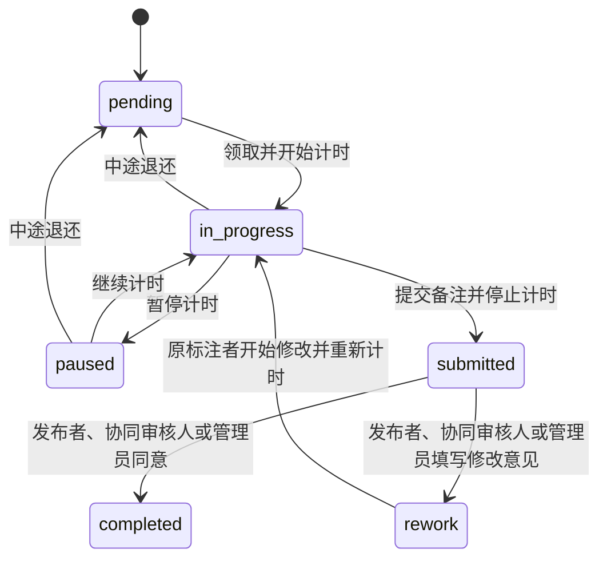
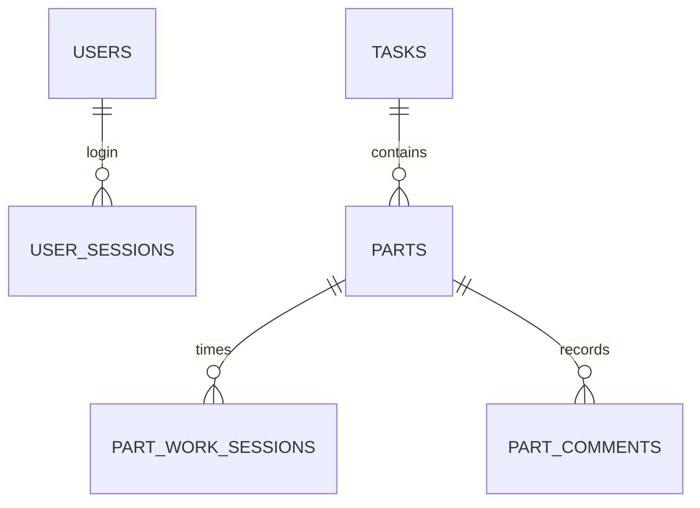

# 多人标注协作平台

`workflow_platform` 只负责人员、任务、Part、计时、备注和审核协作，不上传或处理视频，不调用 GPU Services，也不生成标注文件。

## 任务发布

发布窗口可选择“从任务表格发布”或“手填任务信息”。表格方式支持从 Excel/WPS 复制一行或多行，也支持同时粘贴表头；手填方式可逐项填写以下十项信息，其中申请日期和申请人可自行修改：

1. 申请日期
2. 申请人
3. 项目
4. 标注内容
5. 数据集溯源
6. 每小时可标
7. 数据量
8. 预计工时/单人
9. 数据路径
10. 标注说明书路径

发布时额外设置产品大标签及标注工具，并选择按数量生成 Part、按工作目录清单生成，或“稍后补充 Part”。手填方式至少填写项目或标注内容。申请人是文本；只有填写平台用户名时，该账号才获得已有的申请人查看和维护权限。按数量生成时继续使用 Part 数量和前缀；使用目录清单时，每行目录直接绑定一个 Part。为避免同一清单套到不同数据根目录，目录清单模式一次只发布一行任务。

任务可先发布并编辑信息，不必立即提供 Part。发布者或管理员在任务详情点击“追加 Part”，可按数量或粘贴目录清单生成新的可领取 Part；清单支持预览完整目录和图片数量，并拒绝与已有 Part 重复的目录。修改任务数据根目录只影响之后追加的相对目录，已有 Part 路径保持不变。已完成任务追加 Part 后重新进入领取队列。

## 任务总览

主页面顶部提供“任务表格”和“考勤与工时结算”按钮。结算在同一视图显示每日报到人数、每日完成 Part 数及所选日期的人员与工时明细；时间轴最多为截至所选日期的连续七天，零记录日期也显示。预计完成日期按任务排序与当天报到人数 × 每人 8 小时计算，仅周一至周五参与排期，周六、周日跳过。

管理员可在独立用户管理页面编辑显示名、手机号、角色、启用状态及删除用户。已启用并填写手机号的用户自动成为手动通知的可选对象；无需额外添加通知人员。手动通知支持输入内容、选择机器人以及多选要 @ 的用户，发送时使用用户当前保存的手机号。

管理员在任务表格下方可直接保存上下班时间，并设置两类通知：任务提醒选择任务、机器人、要 @ 的用户及备注；下班日报汇总按预计完成日期和排名升序排列的任务表格、当天报到人数、完成 Part 数、预计完成工时与实际耗时。两类通知均支持预览与手动发送。

自动日报默认关闭，开启后使用已保存的日报机器人、用户和备注；服务每 30 秒检查一次，在周一至周五达到下班时间后发送当日日报。每天的自动发送尝试和结果持久化，服务重启或多个进程不会重复自动发送同一天日报。失败状态显示在任务表格下，可手动补发；服务停机期间不补发过去日期，恢复后可发送当天尚未尝试的日报。

## 上下班报到

顶部不再提供独立考勤设置入口；上下班时间和任务表格下的通知设置仅管理员可见，相关 API 也要求管理员权限。普通用户可查看任务表格和考勤工时结算。

管理员可进入独立的“自动提醒管理”页面（/reminders），分别配置新任务发布、首次领取 Part 开始、优先级变动和全部 Part 审核完成的事件提醒。每种事件独立设置开关、机器人、接收用户及是否同时提醒任务发布者。默认全部关闭；已启用提醒进入数据库队列，每 30 秒处理，最近 30 条发送结果可在页面查看。开始和完成事件每个任务通知一次，优先级仅在值实际变化时通知。

自动提醒管理还提供任务提醒、下班日报文字模板；可插入页面列出的变量，默认 {content} 包含完整生成信息。模板保存后同时应用于手动通知和自动通知。任务提交人指任务的平台发布者，未填写手机号时无法被 @。

所有登录用户可在右上角点击“标注员报到”，每天只记录一次。管理员可在“考勤设置”中设置上班和下班时间，平台显示当天已报到人数。任务总览根据当天报到人数估算任务完成日期：任务按排序依次累加预计工时，每天按 8 小时/人计算产能。当前版本提供报到与实时人数统计，未自动强制阻止非工作时间操作。


所有登录用户可从顶部“任务总览”查看任务汇总或 Part 目录明细。汇总表包含申请日期、申请人、发布者、项目、标签、工具、任务表十项信息、各状态 Part 数量及审核通过率；目录表包含所属任务、工作目录、状态、标注者、领取、提交和审核时间。支持状态、产品标签、关键词筛选及每页 50 条分页。目录搜索匹配项目、Part 名称或路径；任务搜索匹配任务信息。

零 Part 显示“待补充 Part”；全部待领取、全部审核通过分别显示“待领取”“已完成”；进行中、暂停或返工中的任务显示“执行中”；剩余 Part 全部提交时显示“待审核”；其他组合显示“混合状态”。通过率只计算审核通过的 Part，区别于原任务卡按提交与通过数量计算的标注进度。总览公开工作信息，不公开 Part 私人备注、评论及计时明细；这些明细继续遵循任务权限。

## Part 工作目录清单

推荐普通使用者直接双击 `PartDirectoryScannerTool.exe`：点击“选择根目录”，调整最大深度或识别标志，扫描并检查结果后点击“复制清单”，再粘贴到平台发布窗口。无需打开 PowerShell。

开发或部署人员可用以下命令构建：

```powershell
pip install -r requirements\part-scanner-windows.txt
.\scripts\windows\build-part-directory-scanner.ps1
```

生成文件为 `dist\PartDirectoryScannerTool.exe`。下面的 PowerShell 扫描脚本保留为高级或自动化用法：

```powershell
powershell -ExecutionPolicy Bypass -File scripts\windows\scan-part-directories.ps1 `
  -Root D:\dataset -MaxDepth 4 -CopyToClipboard
```

脚本把扫描根目录记为深度 `0`，最多检查到 `MaxDepth`。当某个目录的直接子目录中出现 `images`、`labels` 或 `annotations` 时，该目录会被认定为一个工作目录，并停止继续向下扫描，因此不会把这些数据子目录误当作 Part。可通过 `-MarkerDirectories` 修改标志目录，通过 `-MinimumMarkerCount 2` 要求至少命中两个标志以减少误判。

默认清单是相对于扫描根目录的路径：

```text
split_001
camera_a/split_002
```

平台根据任务表中的“数据路径”拼出完整工作路径。也可以手工使用两列格式 `显示名称<Tab>目录路径`，或直接粘贴完整 UNC、Windows、Linux 路径。标注者领取后会在 Part 卡片中看到并可复制实际工作目录。

## 权限

- 所有登录用户都能查看任务并领取待领取 Part；发布者也可以领取自己发布的任务。
- 普通标注者在任务详情只能看到自己的 Part、备注和计时，以及任务整体数量进度；在任务总览可查看所有任务的目录与状态。
- 任务发布者和管理员均能编辑或删除任务、追加 Part，并查看任务人员统计；发布者可以为任务指定一名协同审核人，该用户能查看全部 Part 明细和人员综合统计，并审核待审核 Part，但不能编辑或删除任务、追加 Part，也不能确认耗时设置是否合理。
- 任务发布者和管理员可以删除任意状态的 Part；未领取 Part 会移出领取队列，进行中或已暂停 Part 会连同当前计时会话一起删除。
- 任务发布者、指定的协同审核人和管理员都能查看任务的完整 Part 明细，并对待审核 Part 执行同意或退回修改。
- 发布者可以删除任意状态的自有任务，管理员可以删除任意任务，包括进行中、待审核和已完成的任务。
- 编辑任务时可更新产品标签、Part 前缀和任务表格中的十项信息；新前缀只用于之后追加的 Part。
- 管理员负责平台账号管理和 Part 审核，可以创建或删除用户、修改用户资料并重置密码。不能删除当前登录账号或最后一个启用的管理员；删除用户时，该用户发布的任务转交给执行操作的管理员，正在标注、暂停或返工的 Part 自动退回待领取，已提交和已完成记录保留原用户名。管理员对任意任务拥有与发布者一致的管理权限，包括任务编辑、删除、追加及删除 Part、Part 信息维护、耗时确认、备注、审核和人员统计；操作日志记录实际操作人，不改变原发布者。
- 管理员可以在任务列表修改数字排名和低、中、高、加急四级优先级；未完成任务按名次从小到大展示，排名 1 最高、数字越小越靠前。移动一个任务时，其余任务会自动前移或后移，刷新列表也会自动修复缺号和重复号，始终保持从 1 开始连续排名。已完成任务不参与排名并始终置于列表底部。排名联动变化、优先级和 Part 删除操作均记录操作人、调整前后值和时间。
- 管理员可打开“人员统计”，按日、周或月查看每个用户参与的标注任务、完成 Part 数量、标注图像数量和耗时，并查看所选周期的总体完成图片数与总体耗时。完成 Part 和图片数量只归入最后一次提交所在周期，审核退回后的复修不会重复计数；跨周期的计时按时间范围截取并保留全部实际复修耗时。

## Part 状态



每次暂停、继续、退还、提交、审核和补充备注均保留历史。累计工时是首次标注与各次返工计时之和。左侧任务卡的进度条表示标注完成度，按“待审核 + 已通过”的 Part 数量计算，因此提交后立即增长，不需要等待集中审核；已通过数量单独显示。发布者还可以在任务创建后填写每个 Part 的预计耗时；实际耗时与预估相差达到 50% 时，平台显示偏差，并允许发布者确认预估是否合理。

## 数据关系


